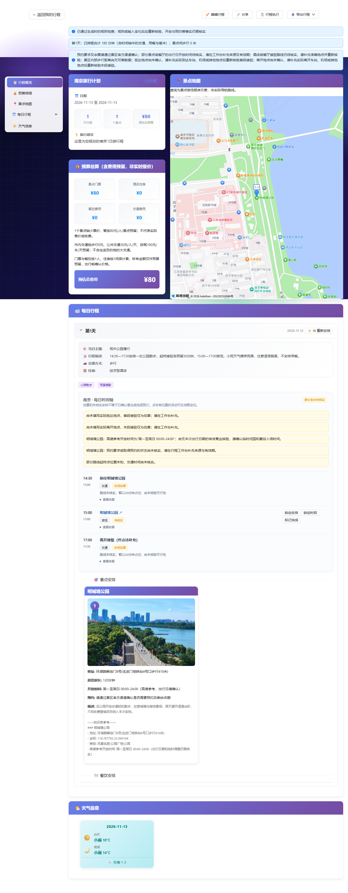
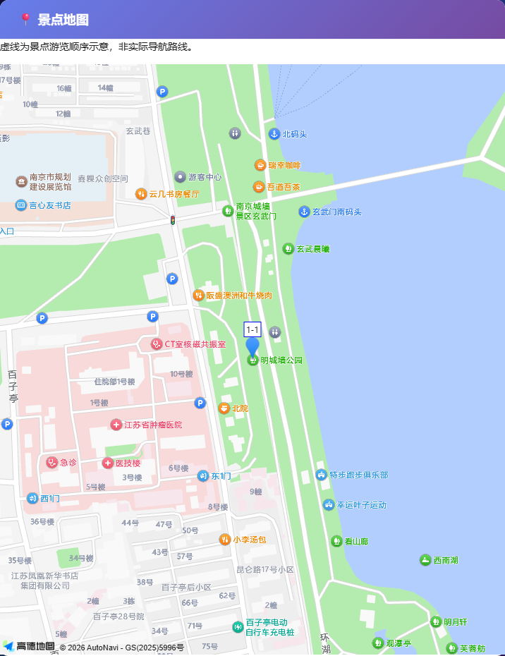
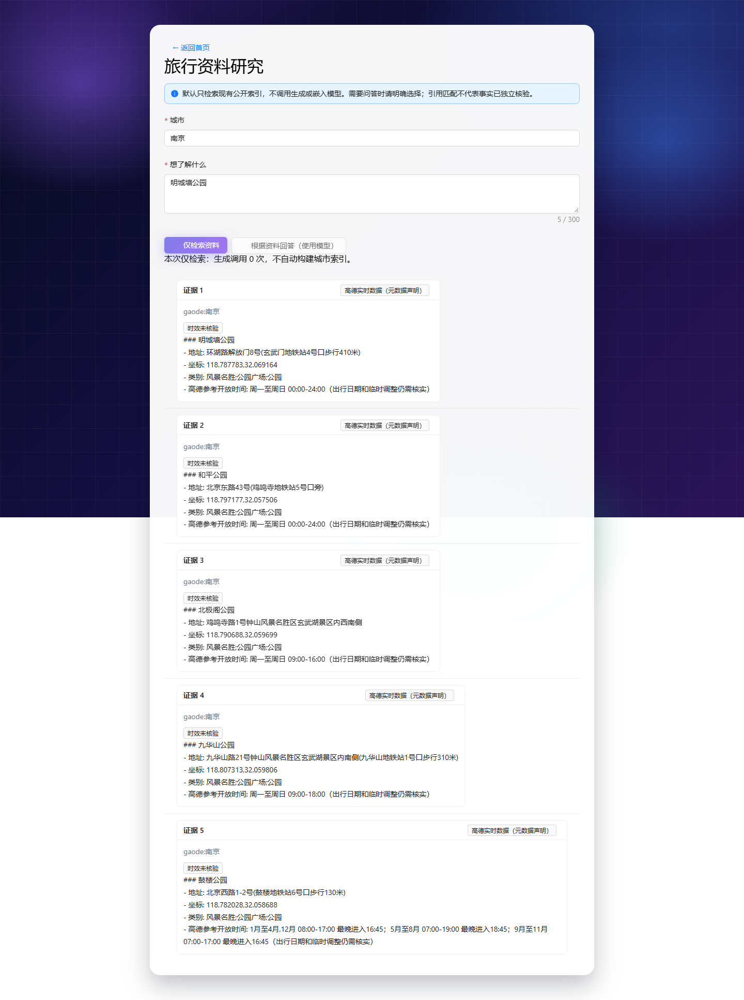
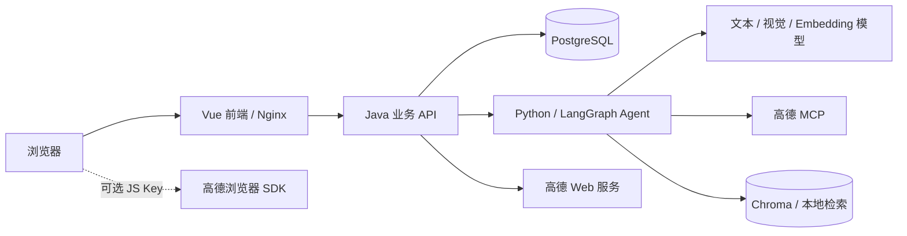

# AI 旅行规划助手

面向国内旅行的单机行程工作台。填写目的地、日期、预算、偏好及固定到离时间，由 **Vue 3、Spring Boot 和 LangGraph** 串起候选查询、逐日规划、时间求解、保存与后续调整。

模型负责整理草案，本地求解器核对时间窗口；营业、预约、路线端点等事实无法核实时保留“待核验”，不会把估算自动当作已确认安排。项目按个人单机使用维护，不提供真实预订或支付。

当前版本：[**v0.1.6 Release**](https://github.com/W205614/langchain-trip-planner/releases/tag/v0.1.6) · [三个公开容器包](https://github.com/W205614?tab=packages&repo_name=langchain-trip-planner) · [版本、摘要与验收边界](docs/evidence/release-v0.1.6-20261112/README.md)

## 可以做什么

| 操作 | 实际能力 |
| --- | --- |
| 创建行程 | 按日期、人数、预算、景点偏好、每日时窗与固定预约整理候选，生成逐日安排和费用说明 |
| 继续调整 | 保存后在行程工作台修改需求、预览并确认改排；刷新或重新登录后继续查看历史记录 |
| 检查与分享 | 展示事实来源、时间轴、失效和待核验项；支持共享及 PNG、PDF、离线 HTML 导出 |
| 使用旅行资料 | 上传资料、审核事实、攻略问答和可选 RAG；Chroma/关键词召回在本地，向量与图文解析依赖外部模型 |
| 管理个人数据 | 账号与权限、配额、反馈、数据导出及注销；邮件、S3、公网 HTTPS 需另配相应外部服务 |

各项是否经过本轮验收，与源码中是否已实现分开记录。本轮真实验证覆盖 RAG、浏览器高德底图和景点图片；SMTP、S3 和视觉没有新增真实联调结论。

## 真实运行画面

下面使用**正常联网配置与合成账号**，展示真实模型和高德生成、保存并刷新后的南京行程。最终成功样本生成使用1次文本模型、34次高德MCP和5次Embedding；整轮还包含保留的先前草稿及排障调用，不能将样本计数当作总费用。

地图底图、景点照片和资料检索均实际可用；时间轴为14:30–17:30，共180分钟。营业、预约和未知接驳如实保留待核验说明：



<details>
<summary>查看地图实拍与资料检索来源</summary>





</details>

[实拍来源、摘要与调用边界](docs/screenshots/release-v0.1.6/README.md)。没有拦截响应、注入行程或隐藏错误。旧截图属于限制外部请求的历史回放，不能用来判断正常配置下高德MCP整体不可用；历史失败记录保留。正式使用仍需自己的有效凭据、网络与额度。

## 架构与目录



Java 管理账号、行程、任务、权限和持久化；Agent 处理规划、时间求解、工具调用与资料检索。外部模型和高德提供的数据仍受权限、额度、时效及覆盖范围约束。

| Compose 服务 | 目录 | 职责 |
| --- | --- | --- |
| `frontend` | [frontend/](frontend/) | 页面、行程工作台、导出与浏览器地图 |
| `backend` | [business-backend/](business-backend/) | Java 业务服务、Flyway 迁移与任务调度 |
| `agent` | [backend/](backend/) | Python Agent、LangGraph、高德工具和 RAG |
| `postgres` | [deploy/images/](deploy/images/) | 本地 PostgreSQL 镜像配方与业务数据 |

[contracts/](contracts/) 管理跨服务契约，[deploy/](deploy/) 放部署与监控模板，[tools/](tools/) 放仓库维护工具；[脚本索引](docs/operations/scripts.md)说明各运行入口。

## 选择启动方式

以下命令在项目根目录使用 **PowerShell** 执行，面向**全新四服务安装**。已有七服务环境沿用[原 Compose、挂载与私有配置](docs/operations/single-host.md#现有七服务部署操作)，不执行首次配置生成器。

| 路线 | 使用场景 | 实际构建范围 |
| --- | --- | --- |
| 预构建应用镜像 | 使用已发布并验收的三个应用 | 拉取 Agent、Java、前端；配套 PostgreSQL 仍需本地构建 |
| 源码 Docker 构建 | 修改应用或复查构建 | 从对应源码构建四个核心服务，包含原生安全回补 |
| 宿主源码开发 | 调试某个模块 | 见[贡献指南](CONTRIBUTING.md)，需要对应 Java、Python、Node 环境 |

已验证发布平台为 **Linux/amd64**，本机使用 Windows Docker Desktop。两条 Docker 路线都需要 Docker Compose、Git、用于配置生成的 Python 3.11+ 与 pip；无需在宿主安装 JDK 或 Node。源码冷构建还会下载编译工具和依赖，时间及资源需求明显高于拉取应用镜像。

### 1. 获取固定版本并准备配置

```powershell
git clone --branch v0.1.6 https://github.com/W205614/langchain-trip-planner.git
cd langchain-trip-planner
Copy-Item backend/.env.example backend/.env
Copy-Item frontend/.env.example frontend/.env
python -m pip install python-dotenv==1.2.3
```

完整 clone 保留维护工具需要的历史对象，不加 `--depth`。GitHub 自动源码 ZIP 可以阅读源码，但不代替完整安全复核环境。

编辑自己的配置，示例占位值须替换为有效配置：

| 文件 / 变量 | 用途 |
| --- | --- |
| `backend/.env`：`LLM_API_KEY`、`LLM_BASE_URL`、`LLM_MODEL_ID` | 后端文本模型；模板默认 `https://api.openai.com/v1` 与 `gpt-6.1-sol`，须具备对应模型权限 |
| `backend/.env`：`AMAP_REST_API_KEY` | Java 使用的高德 Web 服务 Key |
| `backend/.env`：`AMAP_MCP_API_KEY` | Agent 使用的高德 MCP Key；生成器映射为 Agent 的 `AMAP_API_KEY` |
| `frontend/.env`：`VITE_AMAP_WEB_JS_KEY` | 自行构建或 Vite 开发时使用的公开浏览器 JS API Key |
| 项目根 `.env`：`AMAP_WEB_JS_KEY` | 预构建前端启动时使用的公开浏览器 JS API Key |

`LLM_BASE_URL` 填 API 根路径，不附加 `/chat/completions`。模型、Embedding、服务端高德密钥只能放后端；浏览器 Key 类型不同，不能混用。

首次只体验行程规划，可将 `RAG_ENABLED=false`。开启 RAG 时模板使用 `text-embedding-3-large`／3072 维，视觉默认 `gpt-6.1-sol`；各自密钥留空时按模板继承后端模型密钥。已有向量数据切换模型、端点或维度前，先按[索引迁移手册](docs/operations/openai-migration.md)处理。

仅全新安装执行：

```powershell
python backend/scripts/prepare_java_deployment.py
$env:BUILD_REVISION = (git rev-parse HEAD).Trim()
```

生成器创建私有 `deploy/runtime/{postgres,business,agent}.env` 及随机数据库、JWT、内部服务凭据；已有目录会拒绝覆盖。不要删除旧目录后重生成，也不要提交这些文件。默认普通部署不要改 `--output`，Compose 使用固定的 `deploy/runtime/` 路径。

在项目根新建 `.env`；已有文件只补充所需项，不覆盖其他配置：

```dotenv
TRIP_VERSION=v0.1.6
APP_PORT=8380
AMAP_WEB_JS_KEY=
```

浏览器 JS Key 可暂留空查看文本行程；需要地图时填写自己的 JS API Key。服务端 MCP Key 与浏览器 JS Key 是不同配置。`APP_PORT=8381` 可避开被占用的 8380 端口。

### 2A. 使用预构建应用镜像

```powershell
$imageCompose = @('-f', 'docker-compose.yml', '-f', 'docker-compose.images.yml')
docker compose @imageCompose config --quiet
docker compose @imageCompose build postgres
docker compose @imageCompose pull backend agent frontend
docker compose @imageCompose up -d --no-build --wait
docker compose @imageCompose ps
```

必须先准备 PostgreSQL 镜像；三个 GHCR 应用镜像不包含数据库、私有配置、真实上传或向量索引。这里的 `--no-build` 保证应用来自已发布镜像。完整 Registry/config 摘要、对应源码与许可材料见[镜像分发手册](docs/operations/container-distribution.md)。

### 2B. 从源码构建

```powershell
$env:BUILD_REVISION = (git rev-parse HEAD).Trim()
docker compose config --quiet
docker compose up -d --build --wait
docker compose ps
```

此路线重新构建，不承诺与公开镜像逐字节相同。已有构建缓存时，获取前端系统安全更新可执行`docker compose build --pull --no-cache frontend`，再按原Compose启动。复现随发行物保留的历史评估输入时，先按[源码与历史输入说明](docs/operations/container-distribution.md)准备并验证原始文件；不设置伪造的 CI 环境变量，也不将历史报告视为新一轮模型测试。

### 3. 打开并验证

打开 [http://127.0.0.1:8380](http://127.0.0.1:8380)，注册自己的账号并登录；没有默认账号密码。数据库由 Flyway 初始化。模板仅把前端端口绑定到本机，Java、Agent 和 PostgreSQL 不开放宿主端口。

1. 首次选择一个城市、一天行程，填写必要的每日时窗与已知预约。确认供应商额度后提交。
2. 查看任务进度和结果中的待核验项；刷新页面，再从“我的行程”打开同一记录，确认持久化与恢复。
3. 需要调整时在工作台预览并确认改排，检查事实与时间轴后再导出或分享。营业、预约和接驳信息仍应在实际出行前核实。

`healthy` 只说明服务就绪，不代表供应商凭据或真实旅行事实已通过验证。四服务使用结束后保留数据并停止：

```powershell
# 预构建路线继续使用同一组 -f 参数
docker compose @imageCompose stop
# 源码路线使用 docker compose stop
```

不要用 `down -v` 处理配置或启动问题。数据位置、已有七服务的启动与升级、备份及回退边界见[单机运行手册](docs/operations/single-host.md)。

## 验证、开发与运维

本轮修复并真实验证了资料检索、地图、图片与完整时间轴；最终封装镜像恢复同一真实记录、登录和刷新通过，封装恢复检查没有新增供应商调用。过期按实际参与规划的已核实事实计算，不再给所有估算统一套用30分钟过期；输入、事实或真实有效期变化仍要求重新核验。

发布、公开镜像验收、CI与日常环境的最终状态见[v0.1.6证据](docs/evidence/release-v0.1.6-20261112/README.md)。原始安全匹配、逐项适用性结论和历史失败分列保留；未知营业、预约、票价和路线条件不会被改成已确认。正常历史版本保留。

- [贡献与按改动选择测试](CONTRIBUTING.md) · [安全政策](SECURITY.md) · [安全复核规则](docs/operations/security-review-policy.md)
- [时间规划与恢复](docs/operations/final-planning.md) · [事实与费用工作台](docs/operations/trip-operations.md) · [高德 MCP](docs/amap-mcp.md)
- [账号与邮件](docs/operations/email-accounts.md) · [运营及个人数据](docs/operations/public-operations.md) · [对象存储](docs/operations/object-storage.md)
- [公开部署模板](docs/operations/public-deployment.md) · [运行治理](docs/operations/optimization-governance.md) · [历史验收索引](docs/evidence/README.md)

SMTP、S3、公网 TLS、异地恢复和完整七服务克隆恢复需独立联调；本轮没有新增这些结论。项目没有承诺多实例高可用、生产容量或真实预订支付。

## 许可证

原创代码采用 [MIT License](LICENSE)，版权署名 `W205614`。运行截图中的地图、供应商照片与其他第三方素材保留各自条款。第三方运行时、原生补丁、schema、依赖和供应商地图素材保留各自条款，见[第三方许可与分发说明](THIRD_PARTY_NOTICES.md)。镜像中的 `/licenses` 与 Release 对应源码包共同提供原始通知、许可及必要构建材料；项目 MIT 不重新授权第三方组件。
