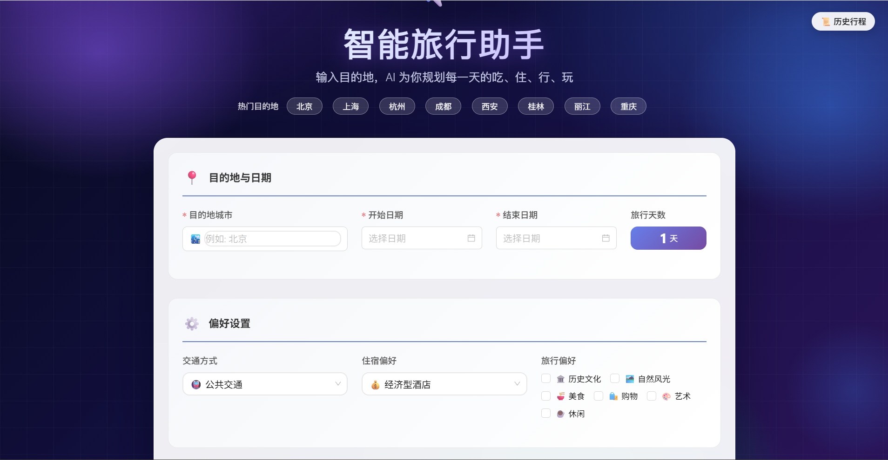
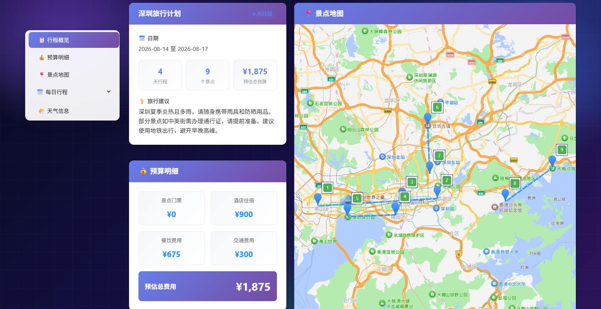
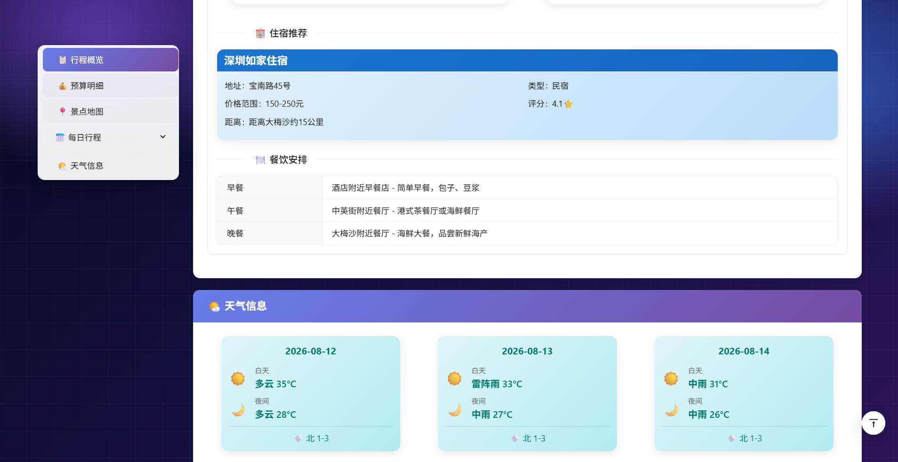
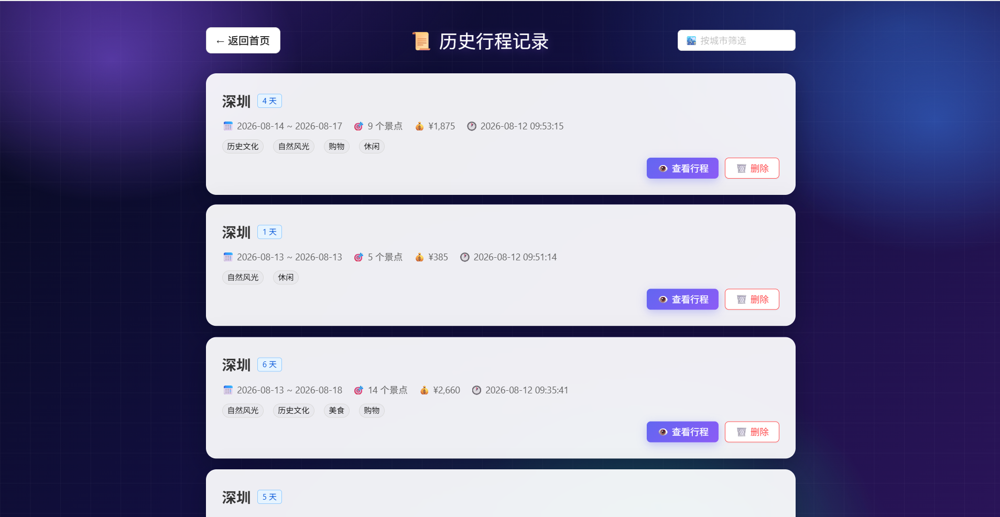

# AI 旅行规划助手

基于 **Vue 3、Spring Boot 和 LangGraph** 的国内旅行规划应用。填写出发地、目的地、日期、人数、预算与偏好，生成可以查看、编辑和导出的逐日行程。

它把景点查询、路线安排、预算整理和出行记录集中到一个应用中，帮助你从“到处查攻略”走到“有一份可以继续调整的旅行计划”。

[快速部署](#快速部署) · [第一次使用](#第一次使用) · [界面预览](#界面预览) · [常见问题](#常见问题)

## 能帮你做什么

| 需求 | 对应功能 |
|---|---|
| 不知道每天怎么玩，景点是否顺路 | 输入每日时间、预约与酒店，按有向路线和时间窗口生成多日时间轴，展示交通、等待、游览和用餐 |
| 跨城时怕赶不上车 | 分段填写城市及自己确认的交通班次、到离时间和位置；每日时长上限计入固定交通与原城接驳，不会从抵达后重新计时；不接真实查票或购票 |
| 计划变了，不想全部重做 | 选择单活动、时段、当天剩余或明确多日范围；锁定和已完成安排受保护，改排先预览差异，再确认或放弃 |
| 生成过程较长，担心刷新丢失 | 持久化任务及有效阶段，在“我的行程”查看、取消或显式恢复；恢复创建关联的新执行，旧执行不能写回 |
| 攻略、历史行程分散 | 保存与筛选历史、查询攻略；可选接入知识检索，PDF／图片资料经过人工复核后发布 |
| 同行人需要一起看、一起准备 | 分享行程，记录行前核验、预订事项和实际费用；社区行程审核后公开 |
| 出门后想随时查看 | 导出 PNG、PDF 或离线 HTML |

行程区分可行、信息不足、计算预算内未找到和当前模型已证明无解。缺失路线可能以明确标注的保守时间占位，不能据此认定可行。费用区分确认、估算与未知；关键费用未知时不会报告总预算已满足。天气、营业和票价仍需出发前核实。 系统推荐的餐厅若无法放入时间轴，会列出餐别、餐厅和就近用餐的待办；用户明确设置的用餐窗口、预约与锁定仍必须保留。

## 界面预览

以下为仓库已有的功能截图，具体布局和字段以当前运行页面为准。

**填写旅行需求**



**查看每日安排、预算与地图**



<details>
<summary>展开查看行程详情与历史记录</summary>





</details>

## 快速部署

下面使用 Docker 在本机启动。命令以 **Windows PowerShell** 为例，均在项目根目录执行；已有部署升级请先看[运行与迁移手册](docs/operations/java-migration.md)，不要覆盖原配置。

### 1. 准备环境并下载项目

需要安装并启动 **Docker Desktop**（包含 Docker Compose），另外准备 **Git、Python 3.11+ 与 pip**。Python 仅用于生成部署配置；Java、Node.js 和应用依赖由镜像构建，无需在本机单独安装。

还需要可用的文本模型 API、高德 Web 服务 Key，以及用于浏览器地图的高德 Web 端（JS API）Key。构建需要联网下载镜像与依赖，生成行程需要访问模型服务和高德 MCP，相关调用可能产生费用。

```powershell
git clone https://github.com/W205614/langchain-trip-planner.git
cd langchain-trip-planner
Copy-Item backend/.env.example backend/.env
Copy-Item frontend/.env.example frontend/.env
python -m pip install python-dotenv
```

### 2. 填写必要配置

用文本编辑器打开以下两个文件，将示例占位值替换为自己的配置：

| 文件 | 配置项 | 填写内容 |
|---|---|---|
| `backend/.env` | `LLM_MODEL_ID` | 模型供应商提供的文本模型名称 |
| `backend/.env` | `LLM_API_KEY` | 对应的模型 API Key |
| `backend/.env` | `LLM_BASE_URL` | 供应商提供的 OpenAI 兼容 API 基础地址 |
| `backend/.env` | `AMAP_REST_API_KEY` | 高德 Web 服务 Key，供 Java 使用 |
| `backend/.env` | `AMAP_MCP_API_KEY` | 高德 MCP 使用的 Web 服务 Key；开发时可与上一项相同 |
| `frontend/.env` | `VITE_AMAP_WEB_JS_KEY` | 高德 Web 端（JS API）Key，用于显示地图 |

`LLM_BASE_URL` 按供应商的接口说明填写，通常包含 `/v1`，不要填成完整的 `/chat/completions` 请求地址。前端地图 Key 与服务端 Web 服务 Key 类型不同，不能混用；模型 Key 只放在后端配置。

**首次只体验行程规划时，将 `backend/.env` 中的 `RAG_ENABLED` 改为 `false`**，其余未列出的配置可先保留模板值。以后需要知识检索，再配置供应商支持的 `EMBEDDING_MODEL`、`EMBEDDING_BASE_URL`、`EMBEDDING_API_KEY` 并开启 RAG；图文资料解析还需要相应的 `VISION_*` 配置。文本模型服务不一定同时支持嵌入和视觉模型。

### 3. 生成配置并启动

```powershell
python backend/scripts/prepare_java_deployment.py
docker compose up -d --build --wait
docker compose ps
```

配置脚本会生成私有的 `deploy/runtime/postgres.env`、`business.env` 和 `agent.env`，自动创建数据库密码、JWT 与内部服务密钥。**只在首次部署执行，不要删除已有目录后重新生成，也不要提交这些私有文件。** 数据库表由 Flyway 在启动时自动初始化。

首次构建需下载依赖，耗时取决于网络与机器。`docker compose ps` 中应看到 `frontend`、`backend`、`agent`、`postgres` 四个服务，启动完成后健康状态应为 `healthy`；容器健康不代表外部 API Key 已验证可用。

打开 **[http://localhost:8380](http://localhost:8380)**，注册自己的账号并登录即可使用，无默认账号密码。默认仅允许本机访问。

如果 8380 已被占用，可先在项目根目录新建 `.env`，写入 `APP_PORT=8381`，再执行启动命令，之后访问 `http://localhost:8381`。

## 第一次使用

1. 注册并登录后，在首页填写出发地、目的地、未来的出行日期、人数、房间数、总预算和偏好。建议先从一个城市、一天行程开始熟悉流程。
2. 提交规划后查看进度；离开页面或刷新后，可以从“我的行程”继续查看任务与结果。“任务”默认显示需要操作的任务，切换“全部任务”可查看已保存结果和普通草稿；普通草稿可以显式恢复有效阶段。已生成的助手提案应打开方案确认或放弃，不能通过通用任务恢复或重新提交处理。
3. 展开时间约束：填写每日出发／结束、首末日到离时间、酒店和预约。预约可选固定活动时段或允许入场窗口；跨城需填写城市分段及自己确认的交通，不会自动查票。国内默认时区 `Asia/Shanghai`。
4. 打开结果，先检查时间轴、事实来源和未解决条件。所有者可锁定活动内容／时段或标记完成；编辑者保留手工调整和账本权限，查看者只读。手工修改相关日期后，旧时间轴会提示重新核验。
5. 在对话中选定允许修改的活动、日期或时段，提出需求。先比较新增、移除、移动、路线及费用变化，再确认；确认写入预览过的方案。原版本、约束、预约或证据变化会阻止过期提案生效，页面会保留提案并区分原因：事实过期先重新核验，版本或规划输入变化则重新加载原行程并生成提案。局部改排后的全程状态仍保留其他日期的冲突、未完成计算和未知条件。
6. 调整满意后导出 PNG、PDF 或离线 HTML；需要同行协作时，再进入行程工作台整理核验、预订与费用。资料核验只提示风险及受影响活动，不会自动改写行程。

## 常用操作与配置更新

以下命令仍在项目根目录执行：

```powershell
# 查看启动问题与最近日志
docker compose logs --tail 100 backend agent frontend

# 暂停服务，保留数据
docker compose stop

# 再次启动
docker compose up -d --wait
```

首次生成配置后，Compose 实际读取的是 `deploy/runtime/*.env`，后续修改 `backend/.env` 不会自动同步到运行配置：

| 修改内容 | 修改位置 | 生效命令 |
|---|---|---|
| 文本模型、RAG、视觉配置 | `deploy/runtime/agent.env` | `docker compose up -d --force-recreate agent` |
| Java 服务端高德 Key | `deploy/runtime/business.env` 的 `AMAP_REST_API_KEY` | `docker compose up -d --force-recreate backend` |
| Agent 高德 Key | `deploy/runtime/agent.env` 的 `AMAP_API_KEY`（脚本从 `AMAP_MCP_API_KEY` 转入） | `docker compose up -d --force-recreate agent` |
| 前端地图 Key | `frontend/.env` 的 `VITE_AMAP_WEB_JS_KEY` | `docker compose up -d --build frontend`，完成后刷新浏览器 |

`docker compose restart` 不会重新载入修改后的环境文件，应使用表中的重建容器命令。不要使用 `down -v` 或删除 `backend/data` 来排查问题；数据库卷、上传文件、索引及私有配置需要成套备份，详见[运行手册](docs/operations/java-migration.md)。

## 常见问题

- **页面打不开或启动失败？** 先确认 Docker Desktop 正在运行、已生成 `deploy/runtime`，再查看 `docker compose ps` 和日志。端口冲突可按上文修改 `APP_PORT`；若首次构建失败，先检查镜像和依赖下载网络。
- **能登录，但无法生成行程？** 检查 Agent 的运行配置中模型名称、API 地址、Key 是否匹配，以及高德 MCP 是否可访问。`AGENT_UNAVAILABLE` 表示 Agent 不可用；登录和历史查看仍可使用。
- **地图不显示或景点没图片？** 核对前端 JS API Key 的类型与高德控制台的安全配置、域名限制，修改 Key 后重新构建前端。某些景点没有可信图片时会显示占位提示。
- **为什么有资料缺口或降级结果？** 可能是路线、餐饮、天气或知识资料不足；未启用 RAG 时也可能缺少攻略上下文。请查看具体提示，调整或补充核验，不要把草稿当作完整方案。
- **中断后恢复是否重新扣费？** 兼容且未过期的阶段可以复用；已发送但尚未持久化响应的调用按不确定处理。新调用仍先预留预算，失败不退计数，不承诺费用 Exactly Once。重复点击恢复使用同一幂等键不会创建多份执行。
- **30 天是否都能算出最优结果？** 输入仍支持 1–30 日，但求解器有候选、路线查询及总时间上限。达到上限会保留有效阶段并说明原因；不承诺全局最优，也没有用短行程测试证明全部长度的性能。
- **需要资料审核管理员？** 先注册账号，再在 `deploy/runtime/business.env` 添加 `BOOTSTRAP_ADMIN_USERNAME=已注册的用户名`，执行 `docker compose up -d --force-recreate backend`。
- **可以直接部署到公网吗？** 本指南面向本机单实例使用；公网部署还需配置 HTTPS、访问入口和备份策略。当前不提供多实例高可用部署。

## 技术栈与进一步阅读

前端使用 Vue 3、TypeScript 与高德 JS API；Java / Spring Boot 负责用户、行程、任务与审核，Python / LangGraph 负责候选生成、高德 MCP 和检索，OR-Tools 负责有界时间窗口求解；PostgreSQL 保存业务数据，Chroma 保存向量索引。Docker Compose 默认启动四个服务，仅前端发布本机端口。

- [运行、升级与备份恢复](docs/operations/java-migration.md)
- [时间规划、受限改排与恢复运维](docs/operations/final-planning.md)
- [本轮验收证据与边界](docs/evidence/final-planning-20261020/README.md)
- [2026-10-25 定向改善与效果证据](docs/evidence/improvement-20261025/README.md)
- [同行协作、预订与费用工作台](docs/operations/trip-operations.md)
- [高德 MCP 接入说明](docs/amap-mcp.md)
- [性能与可靠性说明](docs/operations/performance-reliability.md)
- [历史验收与交付记录](docs/evidence/java-migration/README.md)
