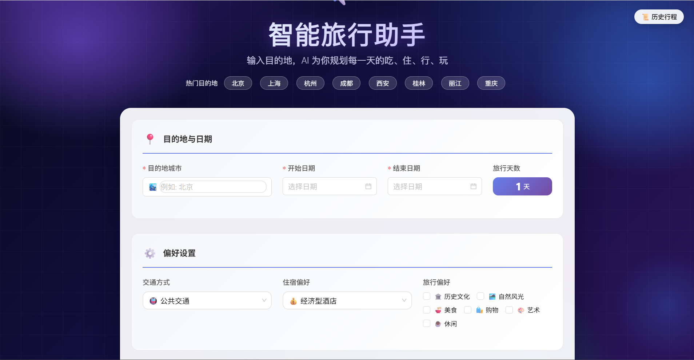
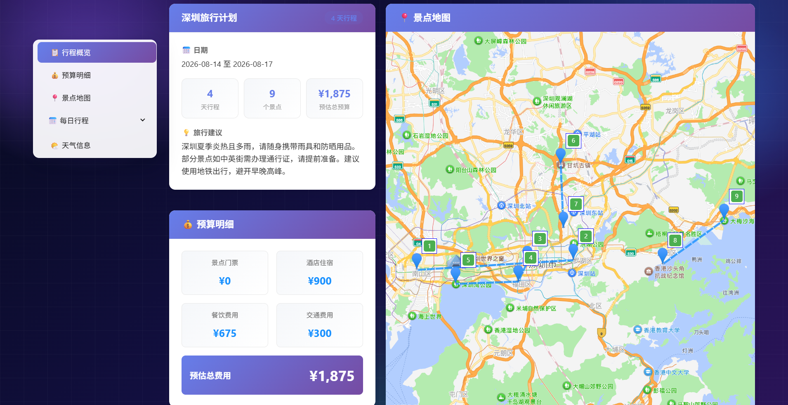
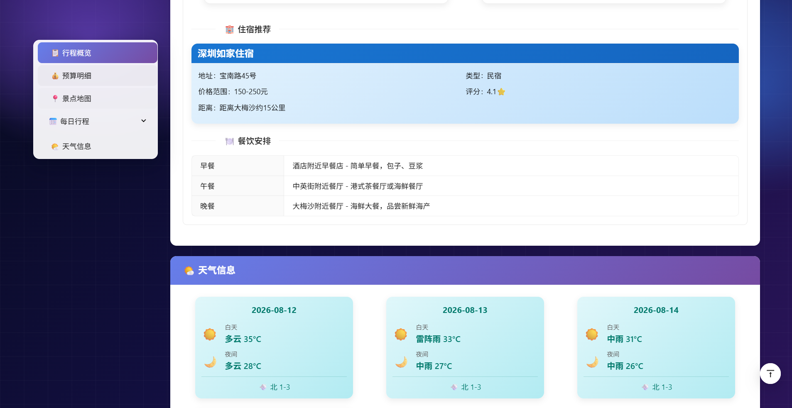
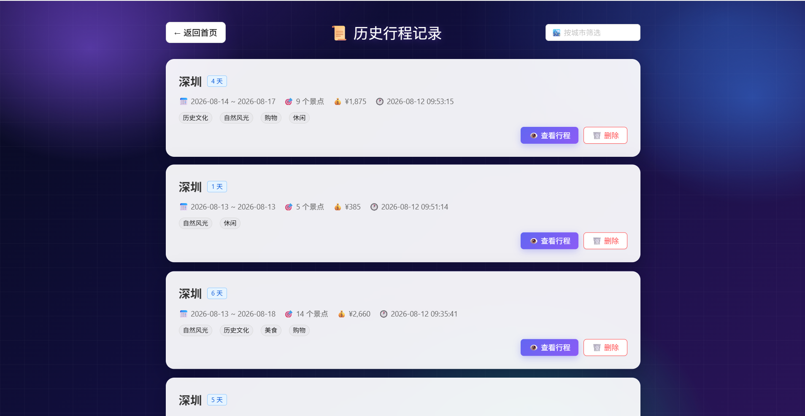

# AI 旅行规划助手

基于 **Vue 3、Spring Boot 和 LangGraph** 的国内旅行规划应用。填写出发地、目的地、日期、人数、预算与偏好，生成可以查看、编辑和导出的逐日行程。

它把景点查询、路线安排、预算整理和出行记录集中到一个应用中，帮助你从“到处查攻略”走到“有一份可以继续调整的旅行计划”。

## 界面预览

以下为仓库已有的功能截图，具体布局和字段以当前运行页面为准。

**填写旅行需求**



**查看每日安排、预算与地图**



<details>
<summary>展开查看行程详情与历史记录</summary>





</details>

## 服务与目录地图

浏览器从前端进入，Java API 处理账号、行程和任务并写入 PostgreSQL，需要规划或检索时调用 Python Agent。

| Compose 服务 | 源码或配置 | 改什么时看这里 |
|---|---|---|
| `frontend` | [Vue 前端](frontend/) | [页面](frontend/src/views/)、[行程交互组件](frontend/src/components/trip/) |
| `backend` | [Java 业务服务](business-backend/) | 账号、行程保存、任务调度、资料审核 |
| `agent` | [Python Agent](backend/) | LangGraph 规划、时间求解、高德工具、知识检索 |
| `postgres` | [Compose 配置](docker-compose.yml) | 业务数据持久化，表结构由 Java 的 Flyway 迁移管理 |

- [contracts/](contracts/) 存放跨服务契约。[deploy/](deploy/) 存放部署模板与监控配置，首次安装生成的 `deploy/runtime/` 包含私有凭据。
- [tools/](tools/) 存放仓库级安全检查与主机维护工具。[脚本索引](docs/operations/scripts.md)按运行环境说明服务端脚本用途。
- [docs/](docs/) 的[单机运行手册](docs/operations/single-host.md)用于日常操作，[验收记录索引](docs/evidence/README.md)用于查历史结果。

**首次安装使用下方四服务模板；已有七服务环境请直接打开[单机运行手册](docs/operations/single-host.md#现有七服务部署操作)。**

## 快速部署

下面使用 Docker 首次创建四核心服务环境。命令以 **Windows PowerShell** 为例，均在项目根目录执行；已有七服务部署沿用[运行手册](docs/operations/single-host.md)中的原 Compose 文件和私有配置，不执行这里的配置生成或首次构建命令。

### 1. 准备环境并下载项目

需要安装并启动 **Docker Desktop**（包含 Docker Compose），另外准备 **Git、Python 3.11+ 与 pip**。Python 仅用于生成部署配置；Java、Node.js 和应用依赖由镜像构建，无需在本机单独安装。

还需要可用的文本模型 API、高德 Web 服务 Key，以及用于浏览器地图的高德 Web 端（JS API）Key。构建需要联网下载镜像与依赖，生成行程需要访问模型服务和高德 MCP，相关调用可能产生费用。

```powershell
git clone https://github.com/W205614/langchain-trip-planner.git
cd langchain-trip-planner
Copy-Item backend/.env.example backend/.env
Copy-Item frontend/.env.example frontend/.env
python -m pip install python-dotenv
```

### 2. 填写必要配置

用文本编辑器打开以下两个文件，将示例占位值替换为自己的配置：

| 文件 | 配置项 | 填写内容 |
|---|---|---|
| `backend/.env` | `LLM_MODEL_ID` | 模型供应商提供的文本模型名称 |
| `backend/.env` | `LLM_API_KEY` | 对应的模型 API Key |
| `backend/.env` | `LLM_BASE_URL` | OpenAI 官方 API：`https://api.openai.com/v1` |
| `backend/.env` | `AMAP_REST_API_KEY` | 高德 Web 服务 Key，供 Java 使用 |
| `backend/.env` | `AMAP_MCP_API_KEY` | 高德 MCP 使用的 Web 服务 Key；开发时可与上一项相同 |
| `frontend/.env` | `VITE_AMAP_WEB_JS_KEY` | 高德 Web 端（JS API）Key，用于显示地图 |

`LLM_BASE_URL` 按供应商的接口说明填写，通常包含 `/v1`，不要填成完整的 `/chat/completions` 请求地址。前端地图 Key 与服务端 Web 服务 Key 类型不同，不能混用；模型 Key 只放在后端配置。

**首次只体验行程规划时，将 `backend/.env` 中的 `RAG_ENABLED` 改为 `false`**，其余未列出的配置可先保留模板值。以后需要知识检索，再配置供应商支持的 `EMBEDDING_MODEL`、`EMBEDDING_BASE_URL`、`EMBEDDING_API_KEY` 并开启 RAG；图文资料解析还需要相应的 `VISION_*` 配置。文本模型服务不一定同时支持嵌入和视觉模型。

### 3. 生成配置并启动

```powershell
python backend/scripts/prepare_java_deployment.py
docker compose up -d --build --wait
docker compose ps
```

配置脚本会生成私有的 `deploy/runtime/postgres.env`、`business.env` 和 `agent.env`，自动创建数据库密码、JWT 与内部服务密钥。**只在首次部署执行，不要删除已有目录后重新生成，也不要提交这些私有文件。** 数据库表由 Flyway 在启动时自动初始化。

首次构建需下载依赖，耗时取决于网络与机器。`docker compose ps` 中应看到 `frontend`、`backend`、`agent`、`postgres` 四个服务，启动完成后健康状态应为 `healthy`；容器健康不代表外部 API Key 已验证可用。

打开 **[http://localhost:8380](http://localhost:8380)**，注册自己的账号并登录即可使用，无默认账号密码。默认仅允许本机访问。

如果 8380 已被占用，可先在项目根目录新建 `.env`，写入 `APP_PORT=8381`，再执行启动命令，之后访问 `http://localhost:8381`。

## 第一次使用

1. 注册并登录，填写出发地、目的地、未来日期、人数和预算。第一次可选一个城市、一天行程。有预约或固定到离时间时，在提交前展开时间约束填写。
2. 提交后查看生成进度。刷新或离开页面，可以在“我的行程”中继续查看。打开结果，先看每天的时间轴、事实来源以及仍需核实的项目。
3. 需要调整时，选择活动或日期，预览变化并确认。满意后可导出 PNG、PDF 或离线 HTML。

## 开发与运维

### OpenAI 模型与公开运营

文本规划、改排和问答默认使用 `gpt-6.1-sol`，图文事实提取也使用该模型；RAG 文档和查询向量使用 OpenAI 官方 `text-embedding-3-large`（3072 维）。三类请求均默认连接 `https://api.openai.com/v1`，视觉和 Embedding 密钥留空时复用后端 `LLM_API_KEY`。高德继续提供地图、POI、天气及路线，Chroma、关键词召回和时间求解在本地运行。

配置切换、真实请求检查和旧索引迁移见 [OpenAI 接入与索引迁移](docs/operations/openai-migration.md)。现有第三方端点生成的向量必须通过新一代索引重建迁移；即使模型名相同，也不能直接混用。历史验收材料保留原供应商名称。

| 能力 | 交付方式与外部条件 |
|---|---|
| 邮箱注册、验证、密码找回、通知订阅 | 已实现；公开模式需配置可用的 TLS SMTP、发件域和 HTTPS 站点地址，参见 [账号与邮件](docs/operations/email-accounts.md) |
| 用户停用、配额、反馈、个人数据导出与注销 | 已实现前后端闭环，参见 [运营与数据管理](docs/operations/public-operations.md) |
| 本地／S3 原文件存储和迁移 | 已实现真实 S3 SDK 适配；Bucket、权限、端点及凭据由部署者提供，参见 [对象存储](docs/operations/object-storage.md) |
| HTTPS、外部告警、云 PostgreSQL | 提供部署配置与联调步骤；域名、DNS、网络和平台账号仍需实际配置，参见 [公开部署](docs/operations/public-deployment.md) |
| 成套备份、加密归档和隔离恢复 | 提供工具与恢复流程，参见 [公开部署](docs/operations/public-deployment.md#备份与恢复)；本机原有备份任务仍停用 |

新安装的公开环境使用独立配置及 `docker-compose.production.yml`、`docker-compose.public.yml`；已有本机环境沿用原安装路径。公网模板要求邮箱验证和管理员 MFA。账号注销会撤回本人共享行程与投稿，索引和文件清理完成前显示处理中；已下载的导出文件、其他人的独立副本及已有备份按各自保留策略管理。

源码、离线集成测试、真实模型抽样与真实云平台联调分别提供证据。SMTP/S3 测试替身通过不等于任何云厂商均已验证，也不提供多实例高可用或真实预订支付。

本次实现与验证边界见[公开运营验收记录](docs/evidence/public-operations-20261107/report.md)：真实行程样本仍存在事实缺口，日常全量索引尚未迁移；云端连接及正式发布需按手册验收。

- [四服务日常操作与常见问题](docs/operations/single-host.md#首次安装后的四服务维护) · [迁移和升级](docs/operations/java-migration.md)
- [时间规划与任务恢复](docs/operations/final-planning.md) · [协作与费用](docs/operations/trip-operations.md) · [高德 MCP](docs/amap-mcp.md)
- [规划、账号与运行治理](docs/operations/optimization-governance.md) · [性能与可靠性](docs/operations/performance-reliability.md) · [原生安全回补](backend/security/native-backports/README.md)

本地检查从仓库根目录执行：

```powershell
cd backend
python -m pytest -q
python scripts/time_window_benchmark.py --output ../.codex-optimization/time-windows.json
cd ../frontend
npm run build
npx playwright test --config playwright.config.ts
```

Python 需要安装锁定依赖，完整浏览器测试需要隔离验证栈和测试管理员配置。可复用 [CI 工作流](.github/workflows/ci.yml) 中的完整准备与执行顺序；单独通过构建或一条脚本不代表整体验收。隔离环境使用专用项目／数据卷和离线供应商，不读取日常业务挂载。
