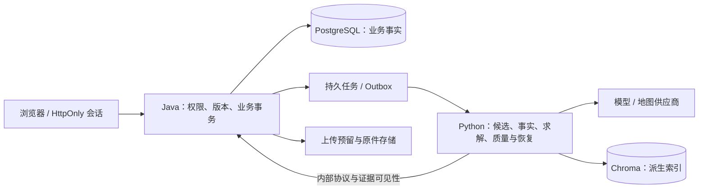

# 架构审查与本轮优化状态

本轮业务源码提交：`220257ad32e50d08cb987d565882f8a038e36c6f`。下文区分已实现、候选实测和待部署验收。日常环境尚未升级，最终 GitHub CI 尚未运行；本文件不是安全认证或上线容量证明。早期 `a01a0d7c` 的原始报告保留，后续实际改动有独立验收。

## 总体判断

Java 管业务权限、版本与最终事务，Python 管受控检索、模型调用和求解，PostgreSQL 保存业务事实、Chroma 保存可重建索引，这个边界适合当前规模。当前不需要增加微服务或 Agent 数量。原来的主要问题出在事实有效性、跨步骤状态和运行恢复闭环；拆文件本身不能解决这些问题。

## 已确认问题与处理

| 优先级 | 原问题 | 本轮处理及证据 | 结论边界 |
|---|---|---|---|
| P0 | 地图查询异常被当作景点不存在，重验会删景点 | 区分已核实、不存在、查询失败；保留原内容，替换需确认。冻结 HTTP 反例由旧版 6→0 改为候选 6→6 | 离线供应商故障，不是所有真实地图错误的覆盖证明 |
| P0 | 条件改变后旧时间轴仍能以新版本被锁定 | 每日输入/事实哈希、期限与服务端绑定；显示、锁定、完成、确认和导出共用有效性规则 | 固定反例返回 `409 SCHEDULE_STALE`，不保证所有现实约束齐全 |
| P1 | 跨城、接驳和整日预算在两种语言间可能含义不同 | 共享规则契约、按当天城市与实际端点核验；过期和未知不能提升为可行 | 留出铁路场景走保守披露分支，未证明该铁路安排可行或全局最优 |
| P1 | 助手简短回复丢失原改排需求 | 持久化原需求、槽位、归属、版本、期限和状态；仍经预览与确认 | 实际浏览器验证刷新后接续，“轻松一点→第2天”可产生改排任务 |
| P1 | 合法引用号和非空回答被过度视为事实支持；检索页面浪费生成 | 纯检索与问答分开；原句支持、来源、时效与 demo 状态检查；不支持时降级为摘录 | 原句匹配不是独立语义真实性判断，更不能承诺消除幻觉 |
| P1 | 上传缺少累计与不确定提交治理 | 写盘前持久原子预留；频率、用户字节、待审核、总量和磁盘水位；同用户去重与待核对原件保留 | 逻辑目录/配额不等于独立物理磁盘或整个数据库的硬配额 |
| P1 | 挂载混用与失锁恢复缺少可验证路径 | 独立新部署配置；既有数据成套登记；Flyway 前拒绝身份不匹配；失锁停止领取并受控重启 | 选定旧备份的 25 个原业务表和 10 条历史迁移未变；独立快照回退通过，仍是单主机 |
| P1 | 浏览器凭证、分享路径、账号恢复与管理权限边界不完整 | Cookie/CSRF、分享日志与引用策略、撤销、离线恢复码、TOTP 与管理员 MFA；管理员不能越权读取私有行程 | 新 token 默认 120 分钟；旧 Bearer 仍按自身 exp/token_version 生效，不因配置自动全部失效 |
| P1 | 事实缺口只提示、缺少补充后重排闭环 | 预约、住宿端点、到站提前量、餐饮及父子关系输入，保留来源和期限；再核验/局部改排 | 用户声明不成为官方事实；两个 POI 编号不同也不能证明语义独立 |
| P1 | 运维缺少真实告警、备份失败语义和容量采样 | 资源上限与日志轮转、载荷保留、受控收件箱、自动备份、镜像预检、数据库体积/采样新鲜度告警 | 失锁演练已有 firing/resolved 和新任务恢复证据；最终候选成功备份仍以对应报告为准 |
| P2 | 多职责服务与结果页过大 | 核验、协作、预订费用、通知用量拆分；前端提案、事实编辑、时间轴和导出分离 | 保持当前部署形态，权限和确认事务继续由 Java 决定 |
| P1 | Agent 非 root 仍保留默认 capability bounding set、SUID 工具和可写根目录 | 最终真实 uvicorn 进程核实 CapEff/CapBnd=0、NoNewPrivs=1、根目录只读；精确移除四个不用的工具，保留有界可写目录 | 11 项检查及恢复后的实际 Agent 读回通过；仍不能排除保留库中的越界写、FFI 或编译模板风险 |
| P2 | 历史页只给草稿显示重验入口 | 本人普通已生成记录也可主动重验，助手提案和服务端权限/版本规则不变 | 最终页面 7 项检查覆盖失败保留、替换预览、保护项和恢复重试 |

## 验收证据如何读

- [HTTP 前后对比](http-comparison-summary.json)：三个冻结开发反例，供应商替代范围明确。
- [浏览器验收](browser-acceptance.json)：8 条独立流程的最新结果通过；失败尝试、真实表单缺陷与测试夹具问题均保留，不能把重跑次数相加。
- [事实编辑补充验收](fact-ui-acceptance-result.json)：来源/有效期、局部改排预览及明确确认 6 项检查通过；[地点核验页面](poi-ui-acceptance-result.json)在最终镜像上 7 项通过，首轮定位失败和第二轮报告丢失的边界保留。
- [实际 Agent 约束](hardened-runtime-probe-result.json)：真实 uvicorn 进程 11 项通过，包括持久 Chroma 组件与小型 CP-SAT。readiness 的 RAG 状态仍为尚未初始化或降级，组件检查不代替业务检索全链。
- [最终挂载恢复](hardened-backup-file-restore-result.json)：成套备份和本机副本 64.13 秒，三份挂载完整哈希解包、真实 Agent 读取恢复数据等共 94.716 秒；复用 Java 身份服务，没有独立恢复 PostgreSQL，不计作生产 RTO 或异机灾备。
- [既有数据演练](existing-data-summary.json)：旧恢复点升级和独立数据回退；不是本次日常切换前的新备份。
- [失锁演练](scheduler-fault-drill-3.json)：新任务拒绝、旧结果拒绝、告警触发/恢复、受控重启后新任务成功；首次超时与后续恢复记录仍保留。
- [留出原始结果](travel-holdout-first-result.json)：首次 16/17。原评分器错误地将输入 ID 当成数据库主键，另有[独立表示审计](holdout-adjudication.json)说明业务字段与同一时间点被保留。原结果不改判，不当作新的 17/17，也不是人工盲评。
- [安全供应链](security-supply-chain.json)：原始漏洞、修补、组件不存在、已回补和仍受影响的供应商 Minor 条目分开记录。门禁通过不等于零漏洞。

## 仍需明确保留的限制

1. 单实例、单主机运行，不提供 HA、SLA 或峰值容量保证。RPO 24 小时、RTO 1 小时是目标，隔离演练耗时不是生产 RTO。
2. 用户已明确暂无异机目标、先完成其他工作，实际异机演练为 `deferred_by_user_not_verified`。同机副本不计作异机灾备。
3. 没有真人盲评、真实外部用户反馈或新的通用规划准确率结论；本轮新增付费供应商调用为 0。
4. 邮件/SMS 恢复未接入；离线恢复依赖用户事先保存恢复码，TOTP 依赖稳定保管独立加密密钥。
5. [最终六镜像扫描](release-220257a-security-summary.json)中 5 个原始 High/Critical 为 0，Agent 原始仍为 79 条，其中 52 条记录对应 8 个供应商 Minor CVE；[逐项部署矩阵](unresolved-cve-deployment-matrix.md)区分已核动态分支不命中、移除的工具入口及仍未知的 native/FFI/模板链，不能把八项统称全部可达或全部无影响。用户随后明确暂时接受精确组合的残余风险，仅限本机受控演示、至北京时间 2026-11-09 23:59:59，仍未修复且不授公开生产许可。冻结记录和当前门禁要求源码树、全部系统包/native ELF、应用文件及现场权限约束等价；不允许自动刷新指纹或用标签代替证据。Chroma 四项无补丁问题另有嵌入式适用条件、到期与源码约束。
6. `pg_database_size` 不包含整个 PG 卷、WAL、其他数据库或宿主机可用空间；不同挂载也不证明物理故障域独立。数据库大小预警不是硬配额。
7. [临时资源提前清理偏差](security-resource-window-deviation.json)及无法恢复旧对象 ID 的审计限制保留。兼容测试通过不能抵消该流程偏差。

候选阶段完成后，仍须进入协调方分配的串行窗口：最新成套备份与登记、保留原挂载的日常重建、业务读回、按精确清单清理、推送并等待最终确切 SHA 的 CI/安全门禁。完成前不将项目标为最终交付。
